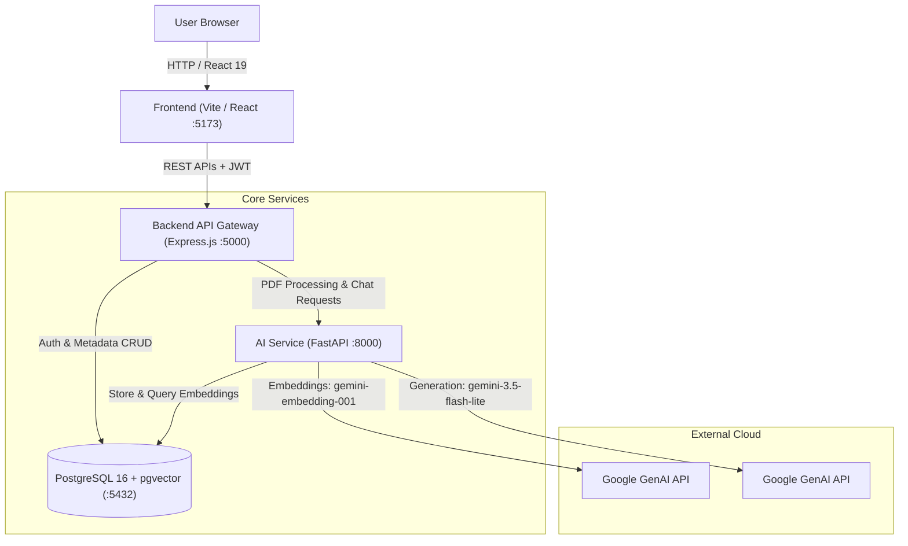

# DocuMind - AI-Powered Document Intelligence & RAG Platform

DocuMind is an enterprise-ready Document Intelligence and Retrieval-Augmented Generation (RAG) platform. It allows users to upload, parse, index, and query complex documents (PDFs) through an interactive, grounded AI chat interface powered by Google Gemini and PostgreSQL `pgvector`.

---

## 📑 Table of Contents

- [Overview](#overview)
- [Key Features](#key-features)
- [Architecture](#architecture)
- [Technology Stack](#technology-stack)
- [Repository Structure](#repository-structure)
- [Local Setup & Installation](#local-setup--installation)
  - [Prerequisites](#prerequisites)
  - [1. Database Setup (Docker or Local Postgres)](#1-database-setup-docker-or-local-postgres)
  - [2. AI Service Setup (Python / FastAPI)](#2-ai-service-setup-python--fastapi)
  - [3. Backend Setup (Node.js / Express)](#3-backend-setup-nodejs--express)
  - [4. Frontend Setup (React / Vite)](#4-frontend-setup-react--vite)
- [Environment Variables](#environment-variables)
- [API Endpoints Reference](#api-endpoints-reference)
  - [Backend Gateway APIs (Port 5000)](#backend-gateway-apis-port-5000)
  - [FastAPI AI Service APIs (Port 8000)](#fastapi-ai-service-apis-port-8000)
- [Testing & Verification](#testing--verification)
- [License](#license)

---

## 🔍 Overview

DocuMind ingests PDF documents, extracts and cleans text, splits content into semantic chunks, and creates 768-dimensional vector embeddings using Google's `gemini-embedding-001`. Vector embeddings are indexed in PostgreSQL using Hierarchical Navigable Small World (HNSW) cosine similarity search. When users ask questions, relevant document chunks are retrieved and provided as context to `gemini-3.5-flash-lite`, which returns strict, grounded answers with source citations and similarity scores.

---

## 🌟 Key Features

- **Document Ingestion & Parsing:** Upload PDF documents with automated validation, metadata tracking, and PyMuPDF text extraction.
- **Semantic Chunking:** Context-aware text chunking with configurable overlap to preserve cross-boundary semantics.
- **Vector Search with pgvector:** 768-dimensional embeddings stored in PostgreSQL with HNSW cosine distance (`<=>`) indexing.
- **Strict Grounded Q&A (RAG):** Responses generated exclusively from retrieved document chunks, avoiding hallucination.
- **Source Citations & Confidence Scores:** Each answer includes expandable source chunks with cosine similarity percentages.
- **Resilient Error Recovery:** Automatic retries for transient Gemini API errors (429, 500, 503) with exponential backoff and friendly user fallbacks.
- **Modern Responsive Dark UI:** React 19 interface with Tailwind CSS v4, fixed full-height sticky sidebar, copy-to-clipboard for AI answers, and safe Markdown formatting (headings, lists, code blocks, bold/italics).
- **Persistent Chat History:** User conversations and assistant responses stored in PostgreSQL for cross-session continuity.
- **JWT Authentication:** Bcrypt password hashing and user-isolated document access control.

---

## 🏗️ Architecture



---

## 🛠️ Technology Stack

| Layer | Technologies |
| :--- | :--- |
| **Frontend** | React 19, Vite 8, Tailwind CSS v4, Axios |
| **Backend (API Gateway)** | Node.js (v18+), Express.js 5, Multer, pg (node-postgres), JWT, bcryptjs, Helmet, CORS |
| **AI / RAG Service** | Python 3.10+, FastAPI, Uvicorn, Google GenAI SDK (`google-genai`), PyMuPDF (`fitz`), psycopg2-binary |
| **Database & Vector Store** | PostgreSQL 16 with `pgvector` extension and HNSW indexing |
| **Containerization** | Docker, Docker Compose |

---

## 📁 Repository Structure

```
DocuMind/
├── .env.example             # Global environment configuration reference
├── .gitignore               # Excludes secrets, venv, node_modules, PDFs, dist
├── README.md                # Project documentation
├── docker-compose.yml       # Docker Compose definition for PostgreSQL + pgvector
├── database/
│   └── schema.sql           # Database initialization schema (tables, pgvector, HNSW index)
├── backend/                 # Node.js Express API Gateway
│   ├── .env.example         # Backend environment template
│   ├── package.json
│   ├── src/
│   │   ├── config/          # PostgreSQL connection pool (db.js)
│   │   ├── controllers/     # authController.js, documentController.js
│   │   ├── middleware/      # authMiddleware.js
│   │   ├── routes/          # authRoutes.js, documentRoutes.js
│   │   ├── services/        # aiService.js (FastAPI client)
│   │   └── server.js        # Express application entrypoint
│   └── uploads/             # Storage folder for uploaded PDFs (.gitkeep preserved)
├── ai-service/              # Python FastAPI RAG Microservice
│   ├── .env.example         # AI service environment template
│   ├── requirements.txt
│   ├── test_rag.py          # Standalone RAG pipeline verification script
│   └── app/
│       ├── database/        # connection.py (psycopg2 connection pool)
│       ├── services/        # pdf_service, chunking_service, embedding_service,
│       │                    # retrieval_service, rag_service, pipeline_service
│       └── main.py          # FastAPI application entrypoint
└── frontend/                # React Vite Tailwind CSS Client
    ├── .env.example         # Frontend environment template
    ├── package.json
    ├── vite.config.js
    └── src/
        ├── components/      # DocumentChat, RecentDocuments, UploadSection, Sidebar, Navbar, MarkdownRenderer
        ├── context/         # AuthContext.jsx
        ├── pages/           # Dashboard.jsx, AuthPage.jsx
        └── services/        # api.js, authService.js, documentService.js
```

---

## 🚀 Local Setup & Installation

### Prerequisites

- **Node.js:** v18.0.0 or higher
- **Python:** v3.10 or higher
- **Docker & Docker Compose** (recommended for pgvector database) OR a local PostgreSQL 16 installation with `pgvector` enabled
- **Google Gemini API Key:** Obtain from [Google AI Studio](https://aistudio.google.com/)

---

### 1. Database Setup (Docker or Local Postgres)

#### Option A: Using Docker Compose (Recommended)

Start the PostgreSQL 16 container with `pgvector` pre-configured:

```bash
docker compose up -d
```

This will automatically execute `database/schema.sql` on first boot, configuring:
- `vector`, `uuid-ossp`, and `pgcrypto` extensions
- Tables: `users`, `documents`, `document_chunks`, `conversations`, `messages`
- HNSW cosine similarity index: `idx_document_chunks_embedding`

#### Option B: Using an Existing PostgreSQL Instance

Connect to your database using `psql` and execute the schema:

```bash
psql -U <username> -d <database_name> -f database/schema.sql
```

---

### 2. AI Service Setup (Python / FastAPI)

1. Navigate to the `ai-service` directory:
   ```bash
   cd ai-service
   ```

2. Create and activate a Python virtual environment:
   ```bash
   # Windows (PowerShell)
   python -m venv venv
   .\venv\Scripts\Activate.ps1

   # Linux / macOS
   python3 -m venv venv
   source venv/bin/activate
   ```

3. Install required Python packages:
   ```bash
   pip install -r requirements.txt
   ```

4. Create your `.env` configuration from the template:
   ```bash
   # Windows
   copy .env.example .env

   # Linux / macOS
   cp .env.example .env
   ```

5. Edit `ai-service/.env` and insert your Gemini API key and database credentials:
   ```env
   HOST=0.0.0.0
   PORT=8000
   DB_HOST=localhost
   DB_PORT=5432
   DB_NAME=documind
   DB_USER=documind_user
   DB_PASSWORD=your_postgres_password_here
   GEMINI_API_KEY=your_gemini_api_key_here
   ```

6. Start the FastAPI AI service:
   ```bash
   uvicorn app.main:app --host 0.0.0.0 --port 8000 --reload
   ```
   Service will be available at `http://localhost:8000`. Interactive docs at `http://localhost:8000/docs`.

---

### 3. Backend Setup (Node.js / Express)

1. Open a new terminal and navigate to the `backend` directory:
   ```bash
   cd backend
   ```

2. Install dependencies:
   ```bash
   npm install
   ```

3. Create your `.env` configuration from the template:
   ```bash
   # Windows
   copy .env.example .env

   # Linux / macOS
   cp .env.example .env
   ```

4. Edit `backend/.env` with your database credentials, JWT secret, and AI service URL:
   ```env
   PORT=5000
   NODE_ENV=development
   DB_HOST=localhost
   DB_PORT=5432
   DB_NAME=documind
   DB_USER=documind_user
   DB_PASSWORD=your_postgres_password_here
   JWT_SECRET=your_super_secret_jwt_key_min_32_chars
   AI_SERVICE_URL=http://localhost:8000
   ```

5. Start the backend in development mode:
   ```bash
   npm run dev
   ```
   Backend will be running on `http://localhost:5000`.

---

### 4. Frontend Setup (React / Vite)

1. Open a new terminal and navigate to the `frontend` directory:
   ```bash
   cd frontend
   ```

2. Install dependencies:
   ```bash
   npm install
   ```

3. (Optional) Create `frontend/.env` if your backend runs on a non-default URL:
   ```bash
   # Windows
   copy .env.example .env

   # Linux / macOS
   cp .env.example .env
   ```

4. Start the frontend development server:
   ```bash
   npm run dev
   ```
   Open your browser at `http://localhost:5173`.

5. To build for production:
   ```bash
   npm run build
   ```

---

## 🔐 Environment Variables

### Backend (`backend/.env`)

| Variable | Required | Default | Description |
| :--- | :--- | :--- | :--- |
| `PORT` | No | `5000` | Port for the Express server |
| `NODE_ENV` | No | `development` | Environment mode (`development` / `production`) |
| `DB_HOST` | Yes | `localhost` | PostgreSQL host |
| `DB_PORT` | Yes | `5432` | PostgreSQL port |
| `DB_NAME` | Yes | `documind` | Database name |
| `DB_USER` | Yes | `documind_user` | Database user |
| `DB_PASSWORD` | Yes | — | Database user password |
| `JWT_SECRET` | Yes | — | Secret string used to sign JWT auth tokens |
| `AI_SERVICE_URL`| Yes | `http://localhost:8000` | Base URL of the FastAPI AI service |

### AI Service (`ai-service/.env`)

| Variable | Required | Default | Description |
| :--- | :--- | :--- | :--- |
| `HOST` | No | `0.0.0.0` | Host interface to bind |
| `PORT` | No | `8000` | Port for the FastAPI server |
| `DB_HOST` | Yes | `localhost` | PostgreSQL host |
| `DB_PORT` | Yes | `5432` | PostgreSQL port |
| `DB_NAME` | Yes | `documind` | Database name |
| `DB_USER` | Yes | `documind_user` | Database user |
| `DB_PASSWORD` | Yes | — | Database user password |
| `GEMINI_API_KEY`| Yes | — | Google Gemini API key for embeddings and Q&A |

### Frontend (`frontend/.env`)

| Variable | Required | Default | Description |
| :--- | :--- | :--- | :--- |
| `VITE_API_BASE_URL` | No | `http://localhost:5000` | Base URL pointing to the Node.js Express backend |

---

## 📡 API Endpoints Reference

### Backend Gateway APIs (Port 5000)

All protected routes require an `Authorization: Bearer <token>` header.

#### Authentication (`/api/auth`)
| Method | Endpoint | Access | Description |
| :--- | :--- | :--- | :--- |
| `POST` | `/api/auth/register` | Public | Register new user account (`name`, `email`, `password`) |
| `POST` | `/api/auth/login` | Public | Authenticate user and receive JWT token (`email`, `password`) |
| `GET` | `/api/auth/me` | Protected | Get current authenticated user profile |

#### Documents & Ingestion (`/api/documents`)
| Method | Endpoint | Access | Description |
| :--- | :--- | :--- | :--- |
| `POST` | `/api/documents/upload` | Protected | Upload PDF document (multipart/form-data) and trigger RAG indexing |
| `GET` | `/api/documents` | Protected | List all documents owned by authenticated user |
| `GET` | `/api/documents/:id` | Protected | Retrieve document details and processing status |
| `DELETE`| `/api/documents/:id` | Protected | Delete document, chunks, and related messages |

#### AI Chat & History (`/api/documents/:id`)
| Method | Endpoint | Access | Description |
| :--- | :--- | :--- | :--- |
| `POST` | `/api/documents/:id/chat` | Protected | Ask question about document (`question`, optional `top_k`) |
| `GET` | `/api/documents/:id/history` | Protected | Retrieve persistent conversation history and citations |

---

### FastAPI AI Service APIs (Port 8000)

| Method | Endpoint | Description |
| :--- | :--- | :--- |
| `GET` | `/api/health` | Health check and database connectivity status |
| `POST` | `/api/documents/{document_id}/process` | Ingests, parses, chunks, and generates vector embeddings for a document |
| `POST` | `/api/documents/{document_id}/chat` | Executes cosine similarity search and Gemini Q&A with source citations |

---

## 🧪 Testing & Verification

1. **Frontend Production Build:**
   ```bash
   cd frontend
   npm run build
   ```
   Produces optimized client bundle in `frontend/dist/`.

2. **Standalone AI Service Pipeline Test:**
   ```bash
   cd ai-service
   python test_rag.py
   ```
   Tests PDF extraction, chunking, embedding generation, vector similarity retrieval, and answer generation.

3. **Backend Health Check:**
   ```bash
   curl http://localhost:5000/api/health
   # Response: {"status":"success","message":"DocuMind backend is running"}
   ```

4. **AI Service Health Check:**
   ```bash
   curl http://localhost:8000/api/health
   # Response: {"status":"healthy","database":"connected",...}
   ```

---

## 🛡️ Security & Privacy

- **Never Commit Secrets:** Real API keys and credentials are saved in `.env` files and excluded by `.gitignore`.
- **Error Sanitization:** Both the Express backend and FastAPI AI service automatically redact sensitive credentials from error responses.
- **Tenant Isolation:** All database queries for documents and chat history enforce ownership validation by `user_id`.

---

## 📄 License

ISC License.
